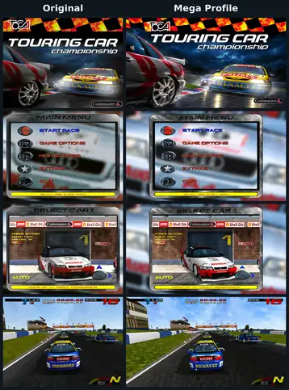

# TOCA Touring Car Championship

A native remake of **TOCA Touring Car Championship** (Codemasters, **1997**),
based on the Windows version with the official **1.1a patch**.
Built with C++23 and SDL3.

Race across ten circuits in Single Race with qualifying and up to 15 rivals,
Time Trial with saved ghosts, or Championship. Two-player split screen and
Linkup are also available, with English, French and German menus and speech.

<a href="original-vs-mega.webp">
  
</a>

## Play

Extract the [release ZIP](https://github.com/Haehnchen/pc-game-toca-touring-car-championship/releases/tag/nightly)
for your system and run `./toca` on Linux or `toca.exe`
on Windows. Keep the supplied folders beside the executable. A working Vulkan
or Direct3D 12 graphics driver is required, depending on the selected SDL backend.

Without saved settings, the game starts fullscreen at **1280×720 (16:9)**, with
VSync on, a **120 FPS** limit and **Mega** detail.
Change graphics, sound and input settings under **Game Options**.

## Mega graphics

Mega adds a graphics profile above the original detail levels, with upgraded
artwork, models and rendering.

Change profiles under **Game Options → Graphics Setup → Detail**, then **Apply / Save**.

- **Vehicles:** rebuilt racing and bonus cars, trackside vehicles and animated
  aircraft, with refreshed textures that retain the original liveries.
- **Track world:** new road, grass, gravel, sky and horizon artwork across all
  circuits, plus upgraded trees, barriers, buildings, signs and other scenery.
- **Cockpits:** rebuilt steering wheels, wipers and driver hands, with dashboard
  upgrades underway.
- **Interface:** sharper fonts, menu icons and HUD artwork, wide menu backgrounds
  and higher-resolution car-selection garages.
- **Draw distance:** twice the Very High viewing range, with roadside objects
  appearing earlier.
- **Opponent detail:** detailed rival cars remain visible farther away, without
  the original nearby-car detail limit.
- **Image quality:** 2× MSAA on supported GPUs, plus mipmaps, trilinear filtering
  and 2× anisotropic filtering for ground textures.
- **Asset optimizations:** compressed models and textures, simplified scenery
  meshes and shared GPU resources reduce duplicated data.

Scenery and cockpit upgrades are still in progress. Original assets fill the
remaining gaps.

## Display

Windowed and fullscreen modes support modern resolutions and these aspect ratios:

| Aspect ratio | Example resolutions |
| --- | --- |
| 4:3 | 640×480, 1024×768, 1600×1200 |
| 16:9 | 1280×720, 1920×1080, 2560×1440, 3840×2160 |
| 16:10 | 1280×800, 1920×1200, 2560×1600 |

Widescreen expands the driving view while keeping menus and HUD elements in
proportion. Custom window sizes, VSync and adjustable FPS limits are available;
presentation speed is independent of simulation and audio timing.

## Controls

Use a keyboard, SDL gamepad or steering wheel, with remappable controls for
each local player. Gamepads provide analog controls, adjustable
sensitivity/deadzone and **vibration feedback**. Compatible wheels support analog
steering/pedals and **force feedback** for impacts, curbs and loose surfaces.

| Action | Keyboard | Gamepad |
| --- | --- | --- |
| Accelerate / brake | ↑ / ↓ | Right / left trigger |
| Steer | ← / → | Left stick |
| Gear up / down | F / V | Right / left shoulder |
| Change camera / rear view | C / hold Z | West / hold North |
| Horn / pause | Hold 1 / Escape | Hold East / Start |

In menus, use the arrow keys, Enter and Escape, or the gamepad stick/D-pad,
South button to confirm and East button to go back.

## Multiplayer

- **Split screen:** two local players with separate cars, controls, cameras and
  HUDs, in horizontal or vertical layouts. The original three/four-player layouts
  are omitted from this remake.
- **Linkup:** up to eight players, one driver per game instance. Use Host/Join
  with the host's IPv4 address and port (default **27015**) to enter the lobby.
- **Car Boost:** optional catch-up assistance in split screen and Linkup.

Linkup uses **ENet instead of DirectPlay** and cannot connect to original-game
clients. The session ends if the host leaves; host migration and matchmaking
are not available.

## Cheats and unlocks

Enter a code at the **driver-name screen** and press Enter, then enter your name.
Most codes toggle when entered again. **Main Menu → Extras** also provides saved
switches for effects and unlocks. Mode restrictions follow the original game;
most effects work in Single Race and Time Trial.

| Code | Effect |
| --- | --- |
| `CMMICRO` | Replaces the far chase view with an overhead camera. |
| `CMCHUN` | Hides the cockpit dashboard and wiper; hands and wheel remain. |
| `CMSTARS` | Fantasy sky and horizon. |
| `CMTOON` | Cartoon sky and horizon. |
| `CMMAYHEM` | Reduces computer-controlled cars' tyre grip. |
| `CMLOGRAV` | Lower gravity for particles and debris. |
| `CMRAINUP` | Rain falls upward. |
| `CMCATDOG` | Replaces rain with cats and dogs. |
| `CMNOHITS` | Disables collisions between cars; barriers remain solid. |
| `CMUPSIDE` | Flips the driving view and reverses steering. |
| `CMHANDY` | Enlarges the driver's hands. |
| `CODIES` | Uses player names in records; already active in this remake. |
| `CMFOLLOW` | Adds trackside camera views. |
| `CMLOCK` | Resets earned circuit, bonus-car and Showdown unlocks. |
| `GONGOGO` | Toggles access to both bonus cars. |
| `CMCOPTER` | Adds an automatic helicopter camera on supported dry circuits. |
| `XBOOSTME` | Doubles game speed; disables Time Trial track-record writes. |
| `JHAMMO` | Unlocks base circuits; Lavaland remains hidden until earned. |
| `CMIMPOSS` | Faster computer-controlled opponents with more grip. |
| `CMGARAGE` | Permanently unlocks both bonus cars. |
| `PATSCREEM` | Permanently unlocks TOCA Showdown. |

**Extras → Unlocks → All circuits** includes **Lavaland**, the bonus circuit.
Turning off Extras switches preserves earned unlocks.

## Saves

Preferences, unlocks, Championship saves and Time Trial records/ghosts use
`${XDG_DATA_HOME:-$HOME/.local/share}/toca/toca/` on Linux. Extras and settings
save automatically; graphics changes need **Apply / Save**.

The remake uses its own save formats; original saves and ghosts cannot be
imported. Ghosts store millisecond timestamps for the fixed **25 Hz simulation**,
keeping playback independent of rendering FPS.

## Build from source

Requires CMake 3.25+, Ninja, Python 3.11+, a C++23 compiler, `zstd` and
ImageMagick with WebP support. [Setup](docs/porting.md).

```sh
make run
```

Release (Linux or Windows/MSYS2 UCRT64):

```sh
cmake --preset distribution
cmake --build --preset distribution
python3 tools/package_release.py --build-dir build/dist
```

Output: `dist/toca-Linux-x86_64.zip` or `dist/toca-Windows-x86_64.zip`.
